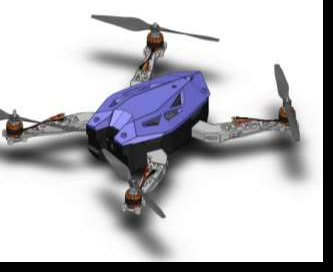
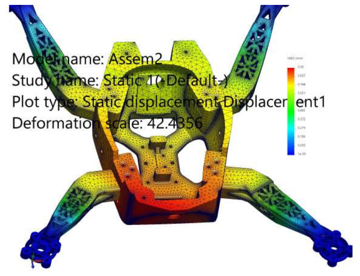
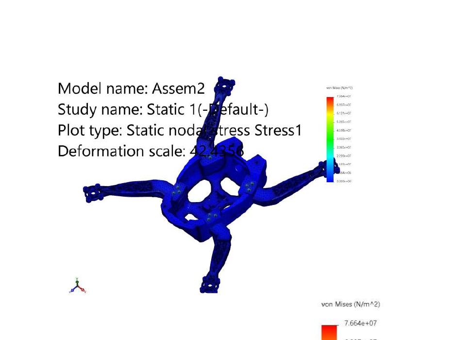
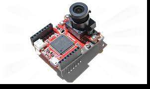
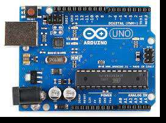
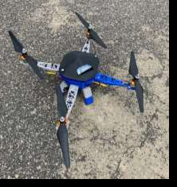
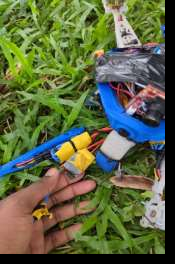
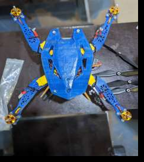

# Object Detection Drone: 3D-Printed Quadcopter

**Final-year B.Eng project · Mechanical Engineering · University of Benin, Nigeria · September 2023**

A 3D-printed quadcopter with an Arduino flight controller, an MPU6050 stability sensor and an OpenMV H7 Plus camera that detects faces and triggers an LED/alarm. The project covers CAD, structural analysis, 3D printing, electronics integration, flight testing and redesign after crashes.

> **Group project.** Completed by a team of four students. See [My role](#my-role) for what I personally did.

## At a glance
| | |
|---|---|
| Type | Final-year group project (B.Eng) |
| Configuration | Quadcopter |
| Frame | 3D printed in PLA, designed in CAD |
| Flight controller | Arduino Uno |
| Stability sensor | MPU6050 (6-axis IMU) |
| Vision | OpenMV Cam H7 Plus, Haar-cascade face detection (Python) |
| Propulsion | 4 × 2200 Kv brushless motors, 4 × 4 A ESCs, 3S LiPo |
| Control | FlySky i6X transmitter and receiver |
| Cost | ₦430,900 ([breakdown](hardware/bill-of-materials.md)) |
| Outcome | Stable flight achieved after three flight tests and two design iterations |

## My role
<!-- Edit to match exactly what YOU did. Keep it honest: recruiters will ask. -->
- Designed and modelled drone parts in SolidWorks/AutoCAD
- Ran stress and displacement analysis on the frame
- 3D printed the components and assembled the drone
- Took part in flight testing and the redesign after crashes

Some of the programming for the vision system was supported by an outsourced programmer, and the team learned the configuration process as part of the project.

## Objectives
1. Design and analyse a lightweight 3D-printed airframe.
2. Manufacture the frame by 3D printing.
3. Integrate the propulsion system (motors, propellers, battery).
4. Integrate the control circuits and flight controller.
5. Integrate a camera for basic real-time object detection.
6. Test flight stability, control response and detection.

## Development workflow
1. Literature review of existing UAV designs
2. Conceptual design of the quadcopter
3. CAD modelling of the frame and components
4. Structural stress, strain and displacement analysis
5. 3D printing the frame in PLA
6. Procurement of electronics, assembly and wiring
7. Flight controller and camera configuration
8. Flight testing, failure analysis and redesign

## Design and analysis
The central hub and arms were modelled in CAD. Static stress, strain and displacement studies were run on the arm and the hub before printing, to check the structure and find where material could be saved or reinforced.

| Displacement study | Stress study |
|---|---|
|  |  |

**Why PLA:** light, easy to print, cheap and quick to re-print after a crash. The trade-offs are brittleness, low heat resistance and poor impact tolerance, which showed up in flight testing. Propellers were bought rather than printed, because weight must be equal on all four arms.

## Electronics and control
| Component | Function |
|---|---|
| Arduino Uno | Flight controller and system integration |
| MPU6050 | Accelerometer and gyroscope; gives tilt and angular rate for stabilisation |
| Brushless DC motors | Propulsion |
| ESCs | Motor speed control |
| 3S LiPo battery, power distribution board | Power supply and distribution |
| FlySky i6X + receiver | Pilot control (throttle, yaw, pitch, roll) |
| OpenMV Cam H7 Plus (480 MHz ARM) | On-board computer vision |

 

## Object detection
Programmed in Python in the OpenMV IDE. The camera captures HQVGA greyscale frames and runs a Haar-cascade `frontalface` detector. When a face is found, a pin goes high to power an LED beacon and alarm. See [`software/openmv/face_detect.py`](software/openmv/face_detect.py).

## Flight testing and redesign
| Test | What happened | Fix |
|---|---|---|
| **1: Stability** | Steady in flight and landing; the IMU and its code worked | None needed |
| **2: Altitude** | Reached about 70 m, lost orientation (front and back looked the same), crashed. Damaged an arm, propellers and an ESC | New arm; colour-coded front and rear arms |
| **3: Piloting** | Stable, responsive flight, then crashed on landing from limited piloting skill. Damaged hardware and bodywork | Redesigned a more crash-tolerant frame, the "Blue Beetle", with clear direction cues |

| Test 1 | Test 2 damage | Redesigned frame |
|---|---|---|
|  |  |  |

More detail in [`results/flight-test-results.md`](results/flight-test-results.md).

## Challenges
- Limited local availability of electronic components
- Cost pressure and exchange-rate changes
- Keeping track of orientation in flight
- Crash damage to structure and electronics
- Tight timeline
- Programming and integrating the vision system

## Skills demonstrated
- **Mechanical:** CAD, structural design, stress/strain analysis, material selection, 3D printing, assembly
- **Electronics:** component integration, motor control, power distribution, sensor integration, wiring
- **Programming:** Arduino, Python on OpenMV, image processing, Haar-cascade detection
- **Testing:** prototyping, flight testing, failure analysis, design iteration

## Lessons learned
- Orientation cues matter as much as stability for piloting.
- Design for crashes, not just for flight.
- Give each test one clear goal so failures are easy to diagnose.

## Future work
- Detect more than faces and refine the algorithm for uses such as agriculture and public safety
- Try stronger, more impact-resistant materials than PLA
- Improve flight stabilisation, navigation and autonomy
- Improve camera performance and data transmission
- Better protection for electronics in the frame

## Notes on accuracy
This documents an academic prototype. The original objectives mentioned carbon-fibre filament, but the frame that was built used PLA. The motion sensor is the MPU6050 (the report also writes "MPU6040" in places). The detection implemented is frontal-face detection only. The cost table follows the report's bill of materials and may differ from the original receipts.

## Tools
SolidWorks · AutoCAD · 3D printing (PLA) · Arduino · OpenMV IDE · MicroPython

## Acknowledgement
Supervised by Dr. E. G. Sadjere, Department of Mechanical Engineering, University of Benin.
